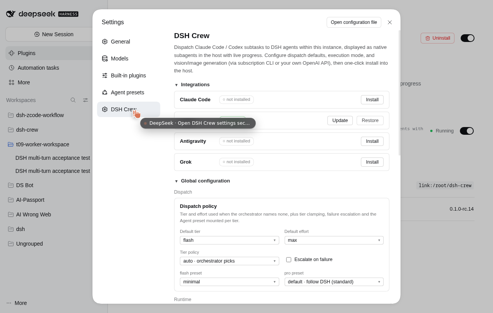

<p align="center">
  
</p>

<h1 align="center">DSH Crew · Multi-turn</h1>

<p align="center">
  <strong>Downstream maintenance line of <a href="https://github.com/ZSeven-W/dsh-crew">ZSeven-W/dsh-crew</a>.</strong><br />
  Dispatch work from Codex / Claude Code / Antigravity into a real <a href="https://github.com/deepseek-ai/deepseek-harness">DeepSeek Harness</a> session — and keep talking to it.
</p>

<p align="center">
  <sub><a href="./README.md">简体中文</a> · English</sub><br />
  <sub>Version <code>1.0.0</code> (unreleased) &middot; Hub tested with DSH <code>0.2.2-rc.1</code>; retains the <code>0.2.1</code> compatibility path</sub>
</p>

---

## What this repo is

This is **not** an upstream release. It is an independently maintained downstream line of
[`ZSeven-W/dsh-crew`](https://github.com/ZSeven-W/dsh-crew), based on upstream commit
[`b0ddd92`](https://github.com/ZSeven-W/dsh-crew/commit/b0ddd92). Upstream's model stays intact:

- the host (Codex, Claude Code, Antigravity, Grok) keeps its own model and its own subagent UI;
- the work runs inside a **DSH agent session** with DSH's tools, presets, sandbox and history;
- tiers `flash` / `pro` pick capability from the DSH roster (`deepseek-v4-flash` / `deepseek-v4-pro`).

What changes here is the **worker protocol**: upstream treats one dispatch as one shot, and kills the
worker when it asks a question. This line makes a worker a persistent, conversational session.

## What's different from upstream

| | upstream `0.1.0-rc.14` | this line |
|---|---|---|
| Follow-up turns | one dispatch = one turn; ask again = new worker | `dsh_worker_message` — `auto` / `steer` / `followup` on the **same session**, `turns[]` keeps every turn |
| Worker asks a question | worker is disposed, job ends `needs_input`; you must re-dispatch | question is **parked** (`pendingQuestions[]`), answer with `dsh_worker_message` or `POST /jobs/:id/answer`, the same turn continues |
| Progress | status shard for the statusline | `GET /jobs/:id/events?since=` ring buffer (500 events) + `turns[]`, rendered in the DSH Web UI |
| Job lifecycle | `done` / `failed` | `queued` → `running` → `idle` / `needs_input`, terminal `done` / `failed` / `cancelled` / `expired` |
| MCP surface | 7 tools | 9 tools (`dsh_worker_message`, `dsh_worker_events` added) |
| Codex integration | roles + prompts | roles rewritten as multi-turn dispatchers, plus a `.codex-plugin` bundle |

Idle workers stay warm for `idle_ttl_seconds` (default 1800 s) and are resumed with
`ctx.agents.resume()` after that, so a long-running conversation survives across hours.

## Plugin UI

The plugin ships its own settings page and jobs board — no separate service.



Open the DSH profile that has the plugin → `More` (bottom left) → `Settings` → `DSH Crew`:

- **Integrations** — one-click install into Claude Code; Codex / Antigravity / Grok status
- **Global configuration** — default tier, `tier_policy`, escalation, per-tier presets, execution mode; flash / pro models are picked as **provider → model from the host's configured catalog**, never typed by hand (no custom-provider form); vision still uses the claude-code / codex / grok / agy CLI bridge
- **Runtime** — hub URL, `question_policy`, `idle_ttl_seconds`, `question_timeout_seconds`
- **Jobs** — jobs grouped by workspace; open one to see every turn and the event tail (added here)

> On this machine the plugin is installed in the main web UI's `web` profile (`127.0.0.1:3080`);
> the separate 3099 workbench has been retired. Worker sessions are ordinary DSH sessions and stay
> visible in the 3080 session list.

## Workspace and token budget

Every worker session lives in one workspace — `dsh-crew`, default
`/root/dsh-workspaces/dsh-crew` (`workspace_root`). The installer creates the
directory; the hub registers the workspace on start (`create(root, 'dsh-crew')`)
and rewrites any caller-supplied `cwd` to it, reporting the ignored value as
`cwd_ignored`.

Tool schemas are re-sent on every model request, so the default
`tools_profile=core` registers five tools; `full` adds
spawn/events/config/probe. Results are brief by default: `status` returns
jobId/status/turn/tokens/pending count, `result` clips at 2,000 characters
(`max_chars`, 0 = no limit), and `verbose: true` gives the full record.
`dsh_worker_message` defaults to `followup` (queues, does not interrupt); only
an explicit `steer` cuts into the current turn. `dsh_worker_status` accepts
`wait_seconds` so callers long-poll instead of looping.

## Install

> The MCP server requires Node 22+, pnpm, and a working DSH install (`dsh` on `PATH`). The DSH `0.2.2-rc.1` host requires Node **24.9.0+**; check the Node version used by the terminal or service that starts DSH as well. Nothing is on npm yet — install from source.

```bash
git clone https://github.com/Augenblick0v0/dsh-crew-multiturn.git
cd dsh-crew-multiturn
pnpm install
pnpm build:client && pnpm build:mcp
```

### 1. Run a DSH profile with the hub

```bash
dsh plugin --profile crew add /absolute/path/to/dsh-crew-multiturn
```

Add `@zseven-w/dsh-crew` to that profile's `dsh.profile.bundles` (in
`~/.dsh/profiles/crew/package.json`), then:

```bash
dsh --profile crew --no-open --port 3099 --host 127.0.0.1
curl -s http://127.0.0.1:3099/_dsh/dsh-crew/ping     # {"ok":true,"service":"dsh-crew-hub"}
```

A systemd unit works well for a permanent hub:

```ini
[Service]
WorkingDirectory=/absolute/path/to/dsh-crew-multiturn
Environment=DSH_HOME=/root/.dsh
ExecStart=/usr/bin/dsh --profile crew --no-open --port 3099 --host 127.0.0.1
Restart=on-failure
RestartSec=3
```

### 2. Point the host at the hub

Codex:

```bash
codex mcp add dsh-crew \
  --env DSHPLUGIN_CREW_HUB=http://127.0.0.1:3099 \
  -- node /absolute/path/to/dsh-crew-multiturn/src/server.mjs
```

> The plugin env prefix is `DSHPLUGIN_` (the legacy `DSH_` prefix is read-only and warns).
> Without it the MCP server silently falls back to a standalone runtime.

Claude Code / Antigravity / Grok: same command shape — register `node src/server.mjs` as an MCP
stdio server with `DSHPLUGIN_CREW_HUB` in its environment.

### 3. Optional: Codex agent roles

```bash
node src/install/cli.mjs codex
```

Installs `ds-flash` / `ds-pro` into `~/.codex/agents/` and the three prompts into `~/.codex/prompts/`.
Each role is a thin dispatcher: it never does the task itself, it calls `dsh_run_worker` and keeps the
`jobId`. There is also a plugin bundle in [`codex/plugin/`](./codex/plugin) for a local marketplace install.

## Use

```text
Use ds-pro to map every module under src/ and write docs/src-map.md.
```

The dispatcher replies with a footer and, more importantly, a job id:

```text
[ds-pro | job: hub-2-mvverhn1 | session: session-7566… | turn: 1 | status: idle | tokens in/out: 1321/31]
```

Continue the same worker — no new session, no context loss:

```text
Continue hub-2-mvverhn1: split that by HTTP method and add curl examples.
```

If the worker needs a decision, it parks the question instead of dying:

```json
{
  "status": "needs_input",
  "pendingQuestions": [{ "id": "q-3f9c…", "question": "Overwrite docs/index.md?" }]
}
```

Answer it (MCP `dsh_worker_message`, or `POST /jobs/:id/answer`) and the same turn resumes.

### MCP tools

| Tool | Purpose |
|---|---|
| `dsh_run_worker` | dispatch and wait for the first turn |
| `dsh_spawn_worker` | dispatch asynchronously, returns a job id |
| `dsh_worker_message` | next turn on the same job — `auto` (steer if running, followup if idle, resume if ended), `steer`, `followup` |
| `dsh_worker_status` | status, turn, current tool, tokens, pending questions |
| `dsh_worker_result` | `{status, turns, result, pendingQuestions}` |
| `dsh_worker_events` | incremental event stream since a sequence number |
| `dsh_worker_cancel` | cancel and release the workspace lock |
| `dsh_worker_config` | effective config + hub reachability |
| `dsh_worker_probe` | probe a provider/model before dispatching |

### HTTP routes

All routes live under `/_dsh/dsh-crew` and are loopback-only (`127.x`, `::1`, `localhost`):

```text
POST /jobs                 create            GET  /jobs            list
GET  /jobs/:id?wait=30     fetch             POST /jobs/:id/message follow-up
POST /jobs/:id/answer      answer question   GET  /jobs/:id/events?since=0
POST /jobs/:id/cancel      cancel            GET  /ping | /config | /presets | /providers
```

## Architecture

```text
Codex / Claude Code / Antigravity
        │  MCP stdio (src/server.mjs)
        ▼
   dsh-crew MCP server ── HTTP loopback ──▶ hub (src/hub/index.mjs)
                                              │  ctx.agents.create / resume
                                              ▼
                                   DSH worker session (flash | pro)
                                   turns, questions, events, tokens
                                              │
                                              ▼
                 DSH Web UI (Settings → DSH Crew) · /jobs board · statusline
```

## Compatibility and state

- Hub mode was tested with DSH **`0.2.2-rc.1`** and Node `24.22.1`: an initial request and same-session follow-up both completed with an explicit model and `max` reasoning effort.
- New hosts use `Agent.model.select()` during session creation and resume, before step preparation fixes the model and effort. Regression tests cover dispatch, follow-up and resume for `flash` / `pro` × `off` / `high` / `max`.
- Previously tested with DSH `0.2.1-rc.4`. Hosts without `Agent.model.select()` retain the original selection hooks, covered by compatibility tests. Standalone mode keeps its existing SDK/runtime configuration and was not included in the new-host live verification.
- Codex `0.162.1` (agent roles + MCP server; plugin bundle in `codex/plugin/`).
- `pnpm test` → 129 tests, all passing; CI runs the Hub model-selection and multi-turn regressions on Node 22 / 24.
- Version starts at **`1.0.0`** (this repo's own line, independent of upstream `0.1.0-rc.x`).
  **No npm publish, no GitHub release, no tag yet** — testing first.

## Staying in sync with upstream

```bash
git remote add upstream https://github.com/ZSeven-W/dsh-crew.git   # once
git fetch upstream
git rebase upstream/main        # or merge, if you prefer a merge history
```

Conflict hotspots: `src/hub/index.mjs`, `src/server.mjs`, `src/worker-question.mjs`,
`codex/agents/*.toml`.

## Add the Crew panel to the main UI (3080)

```bash
dsh plugin --profile web add /absolute/path/to/dsh-crew-multiturn
# then add @zseven-w/dsh-crew to ~/.dsh/profiles/web/package.json bundles
sudo systemctl restart dsh-web
```

Restarting drops the main UI for ~15 s (sessions survive). Or keep it as is: workers on 3099,
the main UI for chat.

## Layout

```text
src/hub/index.mjs      worker registry, turn state machine, routes
src/worker-question.mjs parked questions (ask) vs upstream handoff
src/server.mjs         MCP server, 9 tools
src/hub-client.mjs     loopback client with wait-slicing
src/client/index.tsx   DSH Web UI: settings page, jobs board, turns, event tail
codex/                 agent roles, prompts, plugin bundle
tests/                 node:test suites (79)
```

## License and attribution

MIT. Original work Copyright (c) 2026 ZSeven-W; modifications in this repository are distributed
under the same license. See [LICENSE](./LICENSE). This project is not affiliated with or endorsed by
the upstream maintainers.
