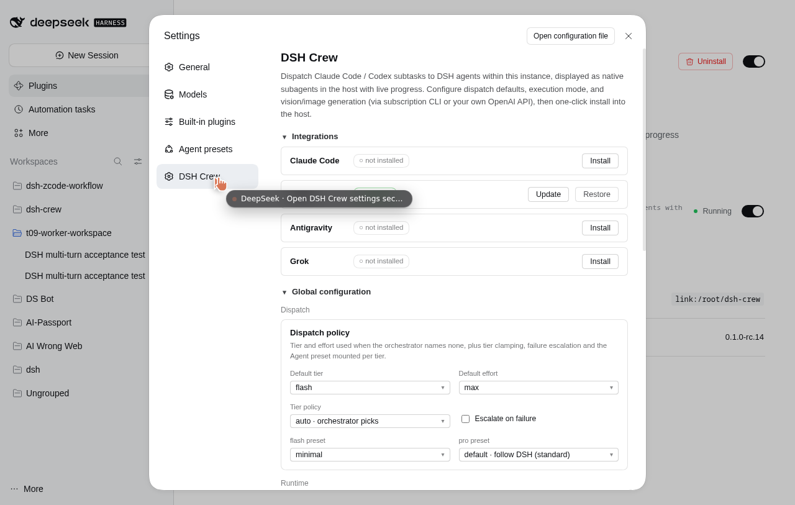

<p align="center">
  
</p>

<h1 align="center">DSH Crew · 多轮版</h1>

<p align="center">
  <strong><a href="https://github.com/ZSeven-W/dsh-crew">ZSeven-W/dsh-crew</a> 的下游维护版本。</strong><br />
  在 Codex / Claude Code / Antigravity 里把活派进真正的 <a href="https://github.com/deepseek-ai/deepseek-harness">DeepSeek Harness</a> 会话——并且能一直聊下去。
</p>

<p align="center">
  <sub>简体中文 · <a href="./README.en.md">English</a></sub><br />
  <sub>版本 <code>1.0.0</code>（未发布） &middot; 已在 DSH <code>0.2.1-rc.4</code> 与 Codex <code>0.162.1</code> 上验证</sub>
</p>

---

## 这是什么

这**不是**上游发行版，而是 [`ZSeven-W/dsh-crew`](https://github.com/ZSeven-W/dsh-crew) 的独立下游维护线，
基线是上游提交 [`b0ddd92`](https://github.com/ZSeven-W/dsh-crew/commit/b0ddd92)。上游的模型保持不变：

- 宿主（Codex / Claude Code / Antigravity / Grok）用自己的模型、自己的子代理界面；
- 活跑在 **DSH agent 会话**里，带 DSH 的工具、预设、沙箱和会话历史；
- `flash` / `pro` 档位从 DSH 花名册里选能力（`deepseek-v4-flash` / `deepseek-v4-pro`）。

改的是 **worker 协议**：上游一次派发就是一轮，worker 一问问题就被销毁；这条线把 worker 变成可追问的持久会话。

## 与上游的差异

| | 上游 `0.1.0-rc.14` | 本仓库 |
|---|---|---|
| 追问 | 一次派发一轮，再问就新开 worker | `dsh_worker_message`（`auto` / `steer` / `followup`）在**同一会话**续跑，`turns[]` 保留每一轮 |
| worker 提问 | 销毁 worker，任务以 `needs_input` 结束，只能重派 | 问题**挂起**（`pendingQuestions[]`），用 `dsh_worker_message` 或 `POST /jobs/:id/answer` 回答，同一轮继续 |
| 进度 | statusline 分片 | `GET /jobs/:id/events?since=` 500 条环形事件 + `turns[]`，DSH Web UI 直接渲染 |
| 任务状态 | `done` / `failed` | `queued` → `running` → `idle` / `needs_input`，终态 `done` / `failed` / `cancelled` / `expired` |
| MCP 工具 | 7 个 | 9 个（新增 `dsh_worker_message`、`dsh_worker_events`） |
| Codex 集成 | roles + prompts | roles 重写为多轮调度器，另带 `.codex-plugin` 包 |

空闲 worker 默认保活 `idle_ttl_seconds`（1800 秒）；超时后用 `ctx.agents.resume()` 恢复，
所以跨小时的连续对话也不会丢上下文。

## 插件 UI

插件自带一块完整的设置页和任务看板，跟着插件走，不需要另开服务。



打开 **运行了这个插件的 DSH profile** → 左下角 `More` → `Settings` → 左侧 `DSH Crew`：

- **Integrations**：一键把 dsh-crew 装进 Claude Code；Codex / Antigravity / Grok 的接入状态
- **Global configuration**：默认档位、`tier_policy`、失败升档、per-tier preset、执行模式（hub / standalone）；flash / pro / 视觉三处模型都从 **DSH 已配置的 provider 与模型目录**里级联选择（provider → model），不再手填，也没有“自定义 Provider”表单
- **Runtime**：hub 地址、`question_policy`、`idle_ttl_seconds`、`question_timeout_seconds`
- **Jobs**：按工作区分组的任务表，点开是每一轮 `turns` 和事件尾部（本仓库新增）

> 本机现在装在主 Web UI 的 `web` profile（`127.0.0.1:3080`），独立的 3099 工作台已停用。
> worker 会话本来就是 DSH 的一等会话，在 3080 的会话列表里也能直接看到。

## 安装

> 需要 Node 22+、pnpm，以及可用的 DSH（`dsh` 在 PATH 里）。还没发 npm，只能从源码装。

```bash
git clone https://github.com/Augenblick0v0/dsh-crew-multiturn.git
cd dsh-crew-multiturn
pnpm install
pnpm build:client && pnpm build:mcp
```

### 1. 起一个带 hub 的 DSH profile

```bash
dsh plugin --profile crew add /绝对路径/dsh-crew-multiturn
```

把 `@zseven-w/dsh-crew` 加进该 profile 的 `dsh.profile.bundles`（`~/.dsh/profiles/crew/package.json`），然后：

```bash
dsh --profile crew --no-open --port 3099 --host 127.0.0.1
curl -s http://127.0.0.1:3099/_dsh/dsh-crew/ping     # {"ok":true,"service":"dsh-crew-hub"}
```

常驻可以用 systemd：

```ini
[Service]
WorkingDirectory=/绝对路径/dsh-crew-multiturn
Environment=DSH_HOME=/root/.dsh
ExecStart=/usr/bin/dsh --profile crew --no-open --port 3099 --host 127.0.0.1
Restart=on-failure
RestartSec=3
```

### 2. 让宿主连上 hub

Codex：

```bash
codex mcp add dsh-crew \
  --env DSHPLUGIN_CREW_HUB=http://127.0.0.1:3099 \
  -- node /绝对路径/dsh-crew-multiturn/src/server.mjs
```

> 插件环境变量前缀是 `DSHPLUGIN_`（旧的 `DSH_` 只读且会告警）。没配这个变量时，MCP server 会静默退回 standalone 运行时。

Claude Code / Antigravity / Grok 同理：把 `node src/server.mjs` 注册成 MCP stdio server，环境里带上 `DSHPLUGIN_CREW_HUB`。

### 3. 可选：Codex 角色

```bash
node src/install/cli.mjs codex
```

会装 `ds-flash` / `ds-pro` 到 `~/.codex/agents/`，三个 prompt 到 `~/.codex/prompts/`。
每个角色都是薄调度器：自己不做任务，只调 `dsh_run_worker` 并记住 `jobId`。
不想手改配置的话，[`codex/plugin/`](./codex/plugin) 里还有一份本地 marketplace 用的插件包。

## 用法

```text
用 ds-pro 把 src 下每个模块梳理一遍，写到 docs/src-map.md。
```

调度器回复末尾会带 job 信息：

```text
[ds-pro | job: hub-2-mvverhn1 | session: session-7566… | turn: 1 | status: idle | tokens in/out: 1321/31]
```

拿这个 id 追问，同一个会话继续：

```text
继续 hub-2-mvverhn1：按 HTTP 方法分组，再补 curl 示例。
```

worker 需要你拍板时不会死，而是挂起问题：

```json
{
  "status": "needs_input",
  "pendingQuestions": [{ "id": "q-3f9c…", "question": "要覆盖 docs/index.md 吗？" }]
}
```

回答（MCP `dsh_worker_message` 或 `POST /jobs/:id/answer`），同一轮继续跑。

### MCP 工具

| 工具 | 用途 |
|---|---|
| `dsh_run_worker` | 派发并等第一轮结果 |
| `dsh_spawn_worker` | 异步派发，返回 job id |
| `dsh_worker_message` | 同一 job 的下一轮：`auto`（运行中 steer、空闲 followup、已结束 resume）、`steer`、`followup` |
| `dsh_worker_status` | 状态、轮次、当前工具、token、待答问题 |
| `dsh_worker_result` | `{status, turns, result, pendingQuestions}` |
| `dsh_worker_events` | 从序号增量取事件 |
| `dsh_worker_cancel` | 取消并释放工作区锁 |
| `dsh_worker_config` | 当前配置 + hub 可达性 |
| `dsh_worker_probe` | 派发前探测 provider/model |

### HTTP 路由

全部挂在 `/_dsh/dsh-crew` 下，仅限 loopback（`127.x`、`::1`、`localhost`）：

```text
POST /jobs                 创建             GET  /jobs            列表
GET  /jobs/:id?wait=30     查询             POST /jobs/:id/message 追问
POST /jobs/:id/answer      回答问题         GET  /jobs/:id/events?since=0
POST /jobs/:id/cancel      取消             GET  /ping | /config | /presets | /providers
```

## 架构

```text
Codex / Claude Code / Antigravity
        │  MCP stdio (src/server.mjs)
        ▼
   dsh-crew MCP server ── 本机 HTTP ──▶ hub (src/hub/index.mjs)
                                            │  ctx.agents.create / resume
                                            ▼
                                 DSH worker 会话（flash | pro）
                                 turns / 提问 / 事件 / token
                                            │
                                            ▼
                DSH Web UI（Settings → DSH Crew） · /jobs 看板 · statusline
```

## 兼容性与状态

- DSH `0.2.1-rc.4`（依赖它的 `SubagentProvider` / `AgentFactory` / `user-questions` seam）。
- Codex `0.162.1`（agent roles + MCP server；插件包在 `codex/plugin/`）。
- `pnpm test` → 79 个测试全过。
- 版本从 **`1.0.0`** 起（本仓库自有版本线，与上游 `0.1.0-rc.x` 无关）。
  **暂未发 npm、暂未建 Release、暂未打 tag**——先测。

## 跟上游同步

```bash
git remote add upstream https://github.com/ZSeven-W/dsh-crew.git   # 只需一次
git fetch upstream
git rebase upstream/main        # 或者 merge，看你喜欢哪种历史
```

冲突高发：`src/hub/index.mjs`、`src/server.mjs`、`src/worker-question.mjs`、`codex/agents/*.toml`。

## 让 Crew 面板出现在主 UI（3080）

```bash
dsh plugin --profile web add /绝对路径/dsh-crew-multiturn
# 再把 @zseven-w/dsh-crew 加进 ~/.dsh/profiles/web/package.json 的 bundles
sudo systemctl restart dsh-web
```

重启会让主 UI 断约 15 秒（会话保留）。也可以维持现状：worker 跑 3099，主 UI 只管聊天。

## 目录

```text
src/hub/index.mjs      worker 注册表、轮次状态机、路由
src/worker-question.mjs 提问挂起（ask）与上游 handoff
src/server.mjs         MCP server，9 个工具
src/hub-client.mjs     loopback 客户端（wait 切片）
src/client/index.tsx   DSH Web UI：设置页、任务看板、轮次与事件尾部
codex/                 角色、prompt、插件包
tests/                 node:test 测试（79）
```

## 许可与署名

MIT。原始代码版权归 ZSeven-W (c) 2026；本仓库的修改以同一许可分发。见 [LICENSE](./LICENSE)。
本项目与上游维护者无隶属关系，也未获其背书。
